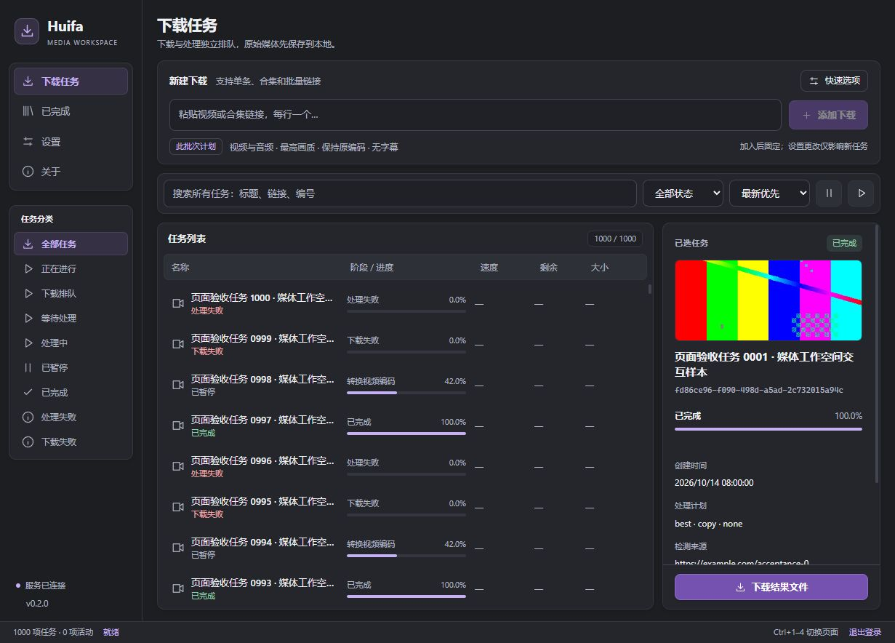

# Huifa Media Downloader

A Rust download and media processing core with a shared React interface for Tauri desktop and Docker web hosts.

[简体中文](README.md) · [Releases](https://github.com/jwwsjlm/huifa-media-downloader/releases/latest) · [Issues](https://github.com/jwwsjlm/huifa-media-downloader/issues)



## Features

- Official yt-dlp, FFmpeg, FFprobe and Deno for videos, audio, collections and batch URLs.
- Separate queues: three ordinary downloads, one special or live download, and one media processing job.
- Format selection, multiple audio tracks, subtitles, chapters, cuts, SponsorBlock, transcoding and audio export.
- Frozen per-task plans and runtime versions, retained sources, pause/resume, restart recovery and offline processing retries.
- Completed media, JPEG crop/padding exports, and AI image editing based on the original cover.
- Encrypted Cookies and AI keys; desktop browser Cookie import and authenticated remote browser login in Docker.
- Chinese/English, dark/light themes, virtual task lists and responsive layouts.
- GitHub Actions releases with SHA-256 checksums and signed desktop updates.

## Install

Choose a file from [Releases](https://github.com/jwwsjlm/huifa-media-downloader/releases/latest):

| Platform | Artifact |
| --- | --- |
| Windows 10/11 x64 | `HuifaDownloader-<version>-windows-x64-setup.exe` |
| Linux x64 | `HuifaDownloader-<version>-linux-x64.AppImage` |
| Docker amd64 / ARM64 | `ghcr.io/jwwsjlm/huifa-media-downloader:<version>` |

Run the Windows installer or make the AppImage executable. Download and processing tools are included; users do not need a separate Python or FFmpeg installation. Updater signatures verify update authenticity; the Windows installer currently has no Authenticode publisher certificate.

The application ID is `com.huifa.downloader.rust`. State is stored under `HuifaDownloaderRust` in the system local data directory; media defaults to the same folder name in the system Downloads directory. Legacy installations and data stay in place; back them up separately. Include `.credentials.key` in Rust data backups to retain encrypted Cookies and AI keys.

Video publishing and publishing accounts are currently disabled.

## Docker

Use `compose.yaml` with a local `.env` file:

```dotenv
HUIFA_IMAGE=ghcr.io/jwwsjlm/huifa-media-downloader:0.2.0
HUIFA_ACCOUNT=your-account
HUIFA_PASSWORD=your-password
HUIFA_PUBLIC_ORIGIN=http://localhost:19491
```

```sh
docker compose up -d --no-build
```

Open the configured origin. For remote access, set it to the actual server hostname or IP. Volumes `rust-data` and `rust-downloads` preserve state and media. Avoid `docker compose down -v` when this data is needed.

Direct HTTP sends login traffic in plaintext; use an HTTPS reverse proxy for public deployment. The container runs as a non-root user; remote Chromium relies on container isolation. Some sites may reject headless login. See [Docker details](docker/README.md).

## Development and releases

Install Node.js 24, Rust stable and the platform's Tauri build dependencies:

```sh
npm ci --prefix frontend
node scripts/acquire-rust-tools.mjs
npm --prefix frontend run tauri -- dev
```

See [development and release instructions](docs/DEVELOPMENT.md) and the [implementation contract](docs/RUST_IMPLEMENTATION.md).

The current tree contains the Rust application. Legacy Python, Qt and Electron code remains recoverable from Git baseline `bf79d1a`; local legacy files were moved to the Windows Recycle Bin.
